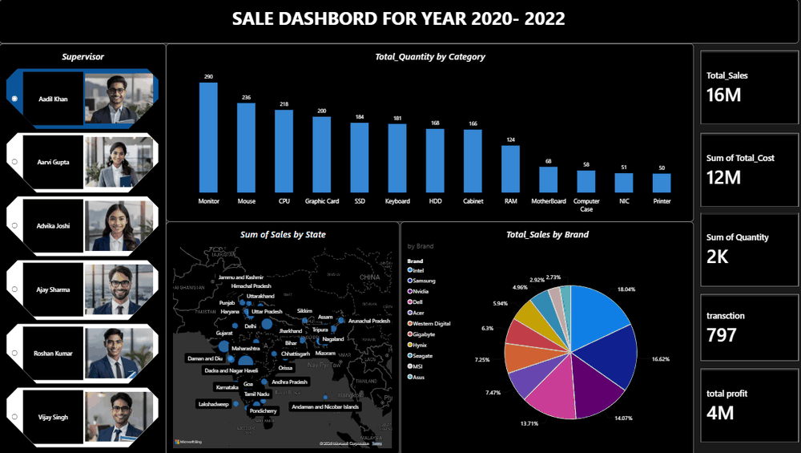

# Techo Sales Dashboard (2020–22) | Power BI

An interactive Power BI dashboard that analyses sales performance for 2020–22. It summarises the key sales KPIs and lets the viewer explore the data by supervisor, product category, brand and state.


> **Live interaction demo:** 

---

## Key KPIs

| KPI | Description |
|---|---|
| **Total Sales** | Sum of all sales |
| **Total Cost** | Sum of all costs |
| **Total Profit** | Calculated with a DAX measure |
| **Total Orders** | Distinct count of order numbers |
| **Total Quantity** | Sum of units sold |

## Visuals

- **Clustered column chart:** quantity sold by product category
- **Pie chart:** share of total sales by brand
- **Map:** sales by state
- **Slicer:** filter the whole dashboard by supervisor

## How to Use (Interactivity)

The dashboard is fully cross-filtered, so every visual updates together:

1. **Click a supervisor** in the left slicer. All KPI cards, charts and the map update to show only that supervisor's data.
2. **Hold `Ctrl` and click** to select more than one supervisor.
3. **Click a brand** in the pie chart or **a state** on the map to filter the other visuals.
4. **Click the same item again** to remove the filter and return to the full data.

## Data Model

| Table | Purpose |
|---|---|
| `Sales_Data` | Main fact table (orders, sales, cost, quantity, category, brand) |
| `State_list` | State lookup used by the map |
| `Supervisor` | Supervisor lookup used by the slicer |

## Tools Used

- Power BI Desktop
- DAX (calculated measure for profit)
- Data modelling (relationships between fact and lookup tables)

## How to Open

1. Download `techo_sale_data_2x.pbix` from this repository.
2. Open it with [Power BI Desktop](https://powerbi.microsoft.com/desktop/) (free, Windows only).
3. Use the slicer and click the charts to explore.

## Repository Structure

```
├── techo_sale_data_2x.pbix   # Power BI report file
├── dashboard.png             # Dashboard screenshot
├── dashboard-demo.gif        # Short interaction demo
├── data/                     # (optional) source data files
└── README.md
```

## Possible Improvements

- Add a line chart for monthly or yearly sales trends
- Add a Profit Margin % KPI
- Add a Year slicer

## Author

**Ayesha Arshad**
[GitHub](https://github.com/YOUR-USERNAME) · [LinkedIn](https://www.linkedin.com/in/YOUR-PROFILE)
